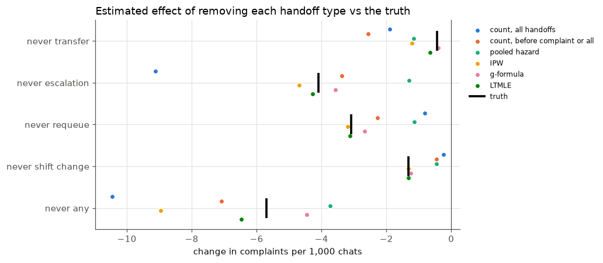

# gmethods

[](https://github.com/raz1470/gmethods/actions/workflows/ci.yml)

**G-methods for time-varying confounding, tested on simulated support chats where the true effect of every handoff is known.**

- A handoff (transfer, escalation, requeue, shift change) makes the customer wait and raises their frustration. Frustration then drives later escalations and complaints. The confounder is caused by earlier treatment, so regression cannot both adjust for it and keep the effect that runs through it.
- LTMLE (doubly robust) recovers every effect without bias across 20 simulated datasets, with influence-function intervals. The parametric g-formula and IPW are included as the classic baselines and cross-checks.
- Naive analyses get the size and even the ranking of the handoff effects wrong. Counting handoffs from the raw log doubles the escalation effect, because escalations are logged after complaints.



## Quick start

```bash
git clone https://github.com/raz1470/gmethods
cd gmethods
uv sync
uv run pytest
```

```python
from gmethods import LTMLE, ChatSimulator, Scenario
from gmethods import interventions as iv

sim = ChatSimulator(Scenario.preset("baseline"))
data = sim.simulate(n_chats=50_000, seed=1)       # .panel, .event_log, .chats
regimes = iv.standard_set() + iv.scale_set()[1:]  # never each type, halve each type

truth = sim.true_risks(regimes, n_mc=500_000)      # the known answer
est = LTMLE().fit(data.panel).estimate(regimes)    # doubly robust, with 95% intervals
print(est.compare(truth))
```

## What is in the package

| Module | What it does |
| --- | --- |
| `gmethods.sim` | `Scenario` (every knob, six presets) and `ChatSimulator` (data and ground truth) |
| `gmethods.interventions` | `natural()`, `never(*types)`, `never_any()`, `scale(*types, factor)`, `standard_set()`, `scale_set()` |
| `gmethods.estimators` | `LTMLE` and `ICE`, `GFormula`, `IPW`, naive baselines, cluster `bootstrap`, diagnostics |
| `gmethods.results` | `RiskTable`: risk, RD, RR and complaints avoided per 1,000 chats |

The same intervention objects drive the truth and every estimator, so a
regime cannot mean one thing in the truth and another in an estimate.

## Recovery study

Twenty datasets of 50,000 chats from the `baseline` preset (ten for the
g-formula and the naive baselines). Mean estimate as a share of the true
effect, so 100% is unbiased. Truth from one million simulated chats per
regime.

| Regime | True effect per 1,000 | LTMLE | g-formula | IPW | Count, all handoffs | Pooled hazard |
| --- | --- | --- | --- | --- | --- | --- |
| never escalation | −4.09 | 100% | 93% | 109% | 219% | 33% |
| never requeue | −3.09 | 96% | 96% | 99% | 19% | 17% |
| never shift change | −1.32 | 82% | 79% | 73% | 5% | 15% |
| never transfer | −0.45 | 156% | 146% | 222% | 476% | 198% |
| never any | −5.69 | 116% | 86% | 114% | 181% | 50% |
| halve escalation | −1.89 | 102% | 94% | 111% | 316% | 37% |
| halve requeue | −1.66 | 96% | 95% | 99% | 18% | 16% |
| halve all | −3.21 | 105% | 98% | 117% | 219% | 46% |

- LTMLE has no systematic bias. Its 95% intervals cover the truth in
  75% to 100% of datasets (92% on average). Shift changes are the weak
  spot: a shift that runs out forces the handoff, so "no shift change" is
  barely observed.
- At 50,000 chats the g-formula often has the lower RMSE: it is biased but
  stable, while LTMLE pays for being unbiased with more variance.
- At 200,000 chats (three datasets) LTMLE's RMSE falls by 2 to 4 times and
  "never any" lands at 99%. The g-formula's error does not fall: it stays
  at 76% to 90% on the larger effects. That bias comes from modelling every
  confounder forward, not from sample size.
- "Never transfer" is the hardest regime: misrouted chats are transferred
  with about 27% probability per turn, so long spells with the wrong team
  barely exist. Halving a handoff type needs only the natural course to be
  supported and is the regime to report.
- Counting every logged handoff doubles the escalation effect: escalations
  logged after a complaint look like causes of it. The pooled hazard holds
  frustration and waits at their observed values and misses most of each
  effect.
- The linear g-formula agrees with `pygformula` (Harvard CAUSALab) on the
  same panel (`results/benchmark_pygformula.csv`,
  `tools/benchmark_pygformula.py`).

Regenerate with `uv run python tools/recovery.py --preset baseline --reps 20`
and `--summarise`.

## Notebooks

1. [`01_simulator`](notebooks/01_simulator.ipynb): the data, one chat end to end, the true effects.
2. [`02_estimators`](notebooks/02_estimators.ipynb): every estimator on one dataset, LTMLE intervals, diagnostics.
3. [`03_recovery`](notebooks/03_recovery.ipynb): bias and RMSE across repeated datasets.

## Docs

- [The simulator](docs/simulator.md): time grid, variables, structural equations, presets.
- [Estimators](docs/estimators.md): g-formula, IPW, naive baselines, bootstrap, diagnostics, using your own panel.

## Development

```bash
uv run --no-default-groups --group test ruff format .
uv run --no-default-groups --group test ruff check . --fix
uv run --no-default-groups --group test pytest -q
```

Notebooks are built by `tools/build_notebooks.py` and the recovery study by
`tools/recovery.py`.

## Licence

MIT
