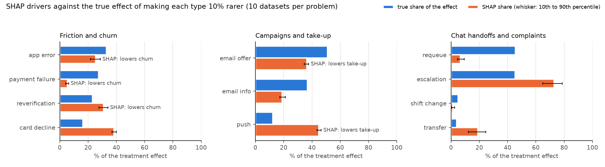
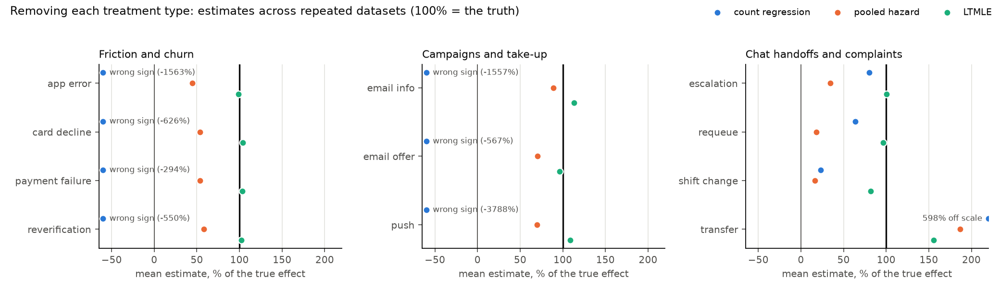
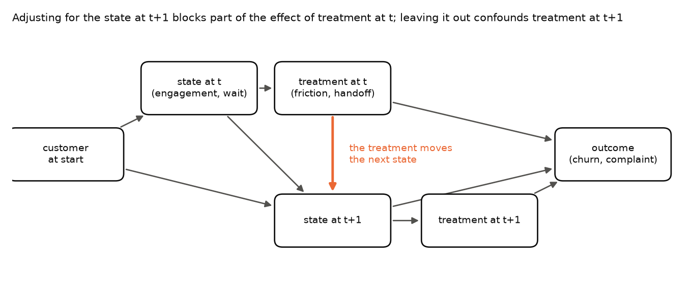
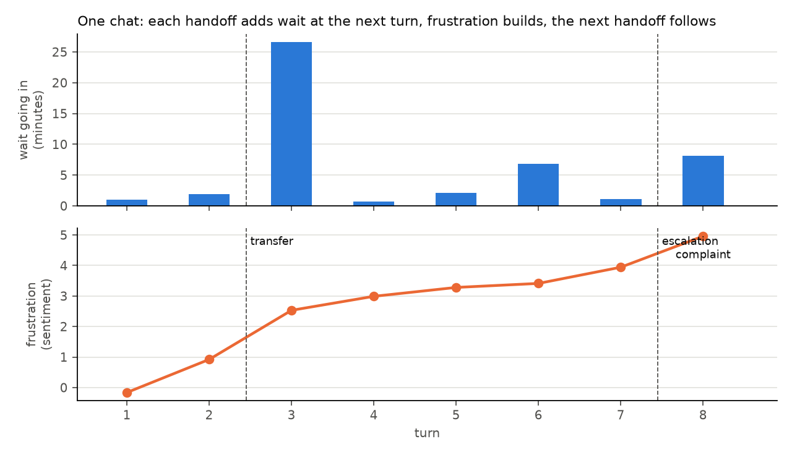
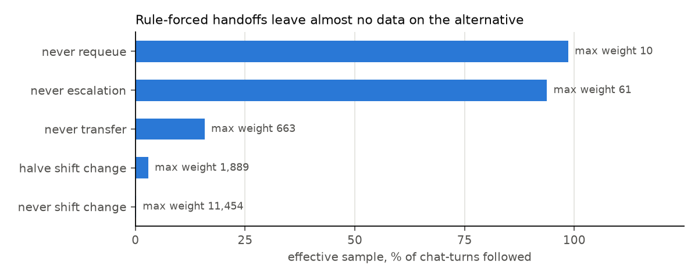

# gmethods

[](https://github.com/raz1470/gmethods/actions/workflows/ci.yml)

**How wrong are SHAP "drivers" when treatments repeat over time? This package simulates three problems where the true answer is known, and estimates it with g-methods.**

A common way to find what drives churn or complaints is to fit a model and rank features by SHAP. When customers get a sequence of treatments, and each one changes the state that decides the next, that ranking answers the wrong question.



Across 10 simulated datasets per problem:

- **Friction and churn.** SHAP ranks card declines first in every dataset (38% of the credit). Their true share is 16%. It says three of the four frictions lower churn, when all four raise it.
- **Campaigns and take-up.** SHAP ranks push first in every dataset (45%). Its true share is 12%. It says push and the offer email lower take-up, when both raise it and the offer has the largest true effect.
- **Chat handoffs and complaints.** Requeues cause 46% of the effect and SHAP gives them 7%. Escalations get 73% against a true 45%, partly because escalations are logged after complaints.

SHAP explains the model's predictions. Here the predictions mix the treatment effect with the state that led to the treatment and with what happened after the outcome. LTMLE, a doubly robust g-method, targets the effect itself and recovers it to within a few percent in all three problems.



## Why this is hard



A treatment (a friction, a campaign, a handoff) changes the customer's next state (engagement, frustration, wait). That state then drives the next treatment and the outcome. Adjusting for it blocks part of the effect, and leaving it out confounds the next treatment. Regression cannot do both, and neither can a predictive model with SHAP on top. G-methods (Robins) were built for this case.

One simulated chat makes it concrete: a transfer at turn 2 leads to a 26-minute wait at turn 3, frustration builds, the chat is escalated at turn 7 and the customer complains at turn 8.



## Quick start

```bash
git clone https://github.com/raz1470/gmethods
cd gmethods
uv sync
uv run pytest
```

```python
from gmethods import LTMLE, ChatSimulator, Scenario
from gmethods import interventions as iv

sim = ChatSimulator(Scenario.preset("baseline"))
data = sim.simulate(n_chats=50_000, seed=1)       # .panel, .event_log, .chats
regimes = iv.standard_set() + iv.scale_set()[1:]  # never each type, halve each type

truth = sim.true_risks(regimes, n_mc=500_000)      # the known answer
est = LTMLE().fit(data.panel).estimate(regimes)    # doubly robust, with 95% intervals
print(est.compare(truth))
```

## What is in the package

| Module | What it does |
| --- | --- |
| `gmethods.sim` | `ChatSimulator` (support chats and handoffs), `FrictionSimulator` (product friction and churn), `CampaignSimulator` (campaigns and product take-up), each with scenarios and ground truth |
| `gmethods.interventions` | `natural()`, `never(*types)`, `never_any()`, `scale(*types, factor)`, `standard_set()`, `scale_set()` |
| `gmethods.estimators` | `LTMLE` and `ICE`, `GFormula`, `IPW`, naive baselines including `ShapDrivers`, cluster `bootstrap`, diagnostics |
| `gmethods.attribution` | Marginal and time-ordered splits of the outcome across treatment types |
| `gmethods.results` | `RiskTable`: risk, RD, RR and complaints avoided per 1,000 chats |

The same intervention objects drive the truth and every estimator, so a
regime cannot mean one thing in the truth and another in an estimate.

## Recovery study: chat handoffs

Twenty datasets of 50,000 chats from the `baseline` preset (ten for the
g-formula and the naive baselines). Mean estimate as a share of the true
effect, so 100% is unbiased. Truth from one million simulated chats per
regime.

| Regime | True effect per 1,000 | LTMLE | g-formula | IPW | Count, all handoffs | Pooled hazard |
| --- | --- | --- | --- | --- | --- | --- |
| never escalation | −4.09 | 100% | 93% | 109% | 219% | 33% |
| never requeue | −3.09 | 96% | 96% | 99% | 19% | 17% |
| never shift change | −1.32 | 82% | 79% | 73% | 5% | 15% |
| never transfer | −0.45 | 156% | 146% | 222% | 476% | 198% |
| never any | −5.69 | 116% | 86% | 114% | 181% | 50% |
| halve escalation | −1.89 | 102% | 94% | 111% | 316% | 37% |
| halve requeue | −1.66 | 96% | 95% | 99% | 18% | 16% |
| halve all | −3.21 | 105% | 98% | 117% | 219% | 46% |

- LTMLE has no systematic bias. Its 95% intervals cover the truth in
  75% to 100% of datasets (92% on average). Shift changes are the weak
  spot: a shift that runs out forces the handoff, so "no shift change" is
  barely observed. `ltmle_weight_summary` flags it (maximum weight above
  10,000, effective sample 0.1%).

  

- At 50,000 chats the g-formula often has the lower RMSE: it is biased but
  stable, while LTMLE pays for being unbiased with more variance.
- At 200,000 chats (three datasets) LTMLE's RMSE falls by 2 to 4 times and
  "never any" lands at 99%. The g-formula's error does not fall: it stays
  at 76% to 90% on the larger effects. That bias comes from modelling every
  confounder forward, not from sample size.
- "Never transfer" is the hardest regime: misrouted chats are transferred
  with about 27% probability per turn, so long spells with the wrong team
  barely exist. Halving a handoff type needs only the natural course to be
  supported and is the regime to report.
- Counting every logged handoff doubles the escalation effect: escalations
  logged after a complaint look like causes of it. The pooled hazard holds
  frustration and waits at their observed values and misses most of each
  effect.
- Cross-checks on the same panels: the linear g-formula agrees with
  `pygformula` (Harvard CAUSALab), and LTMLE agrees with R's `lmtp`
  (Williams and Díaz) on effects and standard errors
  (`results/benchmark_*.csv`, `tools/benchmark_*`).

Regenerate with `uv run python tools/recovery.py --preset baseline --reps 20`
and `--summarise`.

## Notebooks

1. [`01_simulator`](notebooks/01_simulator.ipynb): the data, one chat end to end, the true effects.
2. [`02_estimators`](notebooks/02_estimators.ipynb): every estimator on one dataset, LTMLE intervals, diagnostics.
3. [`03_recovery`](notebooks/03_recovery.ipynb): bias and RMSE across repeated datasets.
4. [`04_attribution`](notebooks/04_attribution.ipynb): share of complaints caused by handoffs, and the marginal split by type.
5. [`05_friction_and_campaigns`](notebooks/05_friction_and_campaigns.ipynb): churn from product friction and product take-up from campaigns.

## Docs

- [The simulator](docs/simulator.md): time grid, variables, structural equations, presets.
- [Estimators](docs/estimators.md): LTMLE, g-formula, IPW, naive baselines, bootstrap, diagnostics, using your own panel.
- [Friction and campaign simulators](docs/weekly_simulators.md): the same methods on churn from product friction and on product take-up from campaigns.
- [Attribution](docs/attribution.md): how many complaints handoffs cause, and the marginal split across handoff types.

## Development

```bash
uv run --no-default-groups --group test ruff format .
uv run --no-default-groups --group test ruff check . --fix
uv run --no-default-groups --group test pytest -q
```

Notebooks are built by `tools/build_notebooks.py`, the recovery study by
`tools/recovery.py`, the SHAP figure by `tools/make_shap_figure.py` and the
other figures by `tools/make_figures.py`.

## Licence

MIT
